# Verification evidence — Campus Café Pre-order

<!-- Issue #33. Blocks between name markers are rewritten by npm run evidence from the real run; do not edit them by hand. -->

<!-- COMMIT -->
Tested commit: `6a02f6c69f79ac7f201258c30d15bb415a3d9609` (branch `docs/final-evidence`), run at 2026-11-05T23:43:33.655Z. Generated by `npm run evidence` (scripts/evidence.mjs) — do not edit by hand.

**Release reference:** branch `sprint-1`; the release to `main` and tag `v0.1.0-sprint1` are made by the students — if a release is made, `npm run evidence` is run again on it and this line names it.
<!-- /COMMIT -->

## F.1 Setup summary

Needs Node 24 and Docker Desktop. Full steps in `README.md`.

```bash
npm install
cp server/.env.example server/.env          # set your own SEED_PASSWORD (never committed)
npm run db:up                               # Postgres 16 in Docker, port 5433
npm run db:migrate && npm run db:seed       # tables + 3 accounts + 6 menu items (Croissant sold out)
npm run dev                                 # app http://localhost:5173, API :3000
npm test                                    # server (cafe_test DB) + client tests
npx playwright install chromium && npm run test:e2e   # end-to-end, phone + desktop (cafe_e2e DB)
npm run evidence                            # re-runs everything, rewrites docs/evidence/*.md
```

Seeded test accounts (synthetic data): `alice@cafe.test`, `bob@cafe.test` (CUSTOMER), `staff@cafe.test` (OPERATOR). The password is the `SEED_PASSWORD` each student sets locally; it is not in Git or in this PDF.

## F.2 Program demonstrations

All screenshots were taken by the end-to-end tests (Playwright) on the commit in F.3, so each one is also an automated check. Phone width 375 px unless marked desktop.

### Scenario 1 — Normal journey and retrieval of the saved order (F-02, F-03)

| | |
|---|---|
| Feature / AC | F-03 AC-F03-10 (TEST-F03-19); menu display F-02 AC-F02-06 (TEST-F02-08) |
| Role | CUSTOMER (alice) |
| Start | Seeded database, no orders; alice logged in on `/menu` |
| Steps | Add Latte twice and Thai Milk Tea once → open cart → **Place order** → open **My orders** |
| Expected | One Latte line ×2; estimated ฿180.00; after placing: `/orders/N`, "Order #N placed!", server total ฿180.00, status PLACED; the order is in My orders with 3 items |
| Actual | As expected; the test also reads the order from the database: `total = 18000` satang |

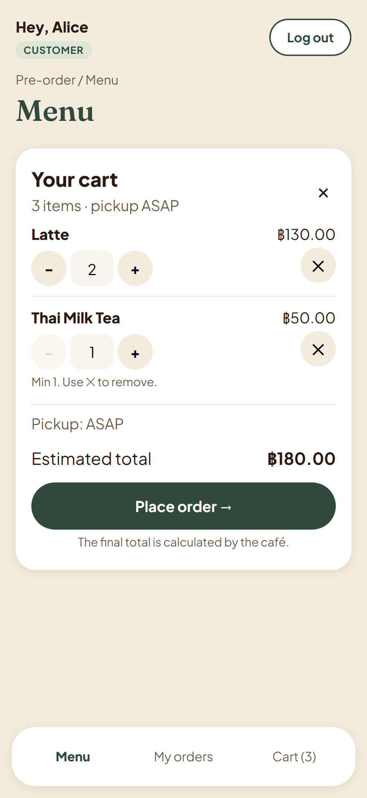
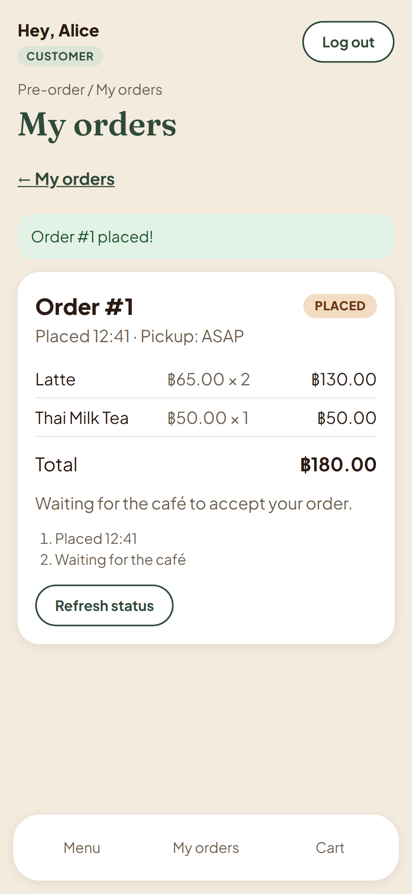
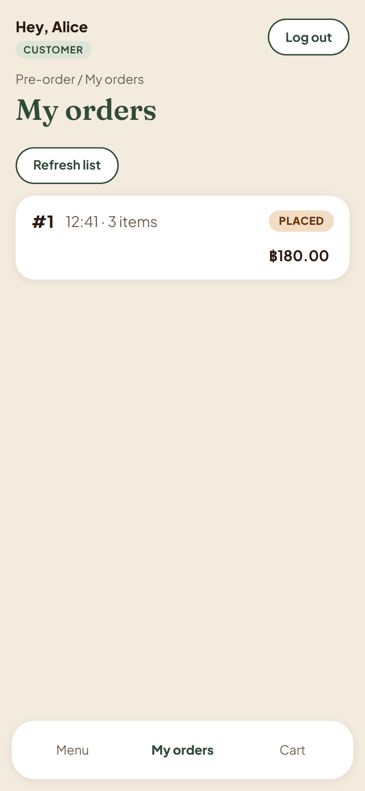

### Scenario 2 — Operator accepts the order (F-04)

| | |
|---|---|
| Feature / AC | F-04 AC-F04-11, AC-F04-12 (TEST-F04-11, TEST-F04-12) |
| Role | OPERATOR (staff) |
| Start | Two PLACED orders (alice 6 min ago, bob 2 min ago) |
| Steps | Log in as staff → queue → **Accept order** on the oldest |
| Expected | Queue oldest first, count 2; after accept: "Order #N accepted.", card gone, order ACCEPTED in the database |
| Actual | As expected |

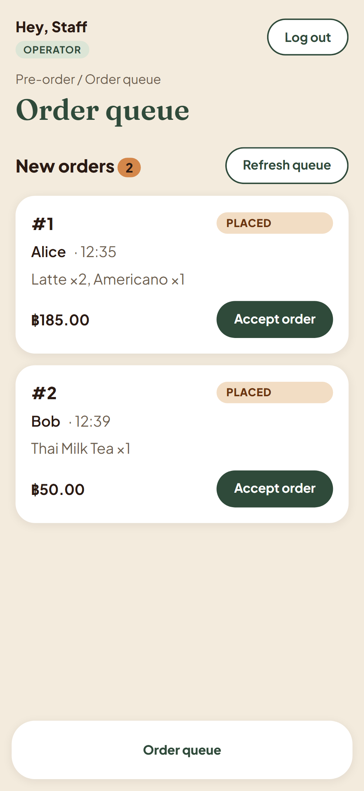
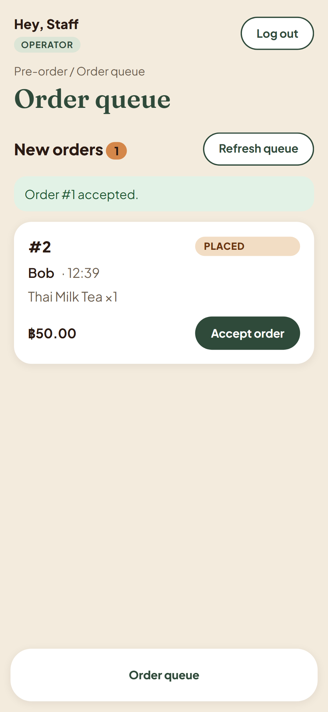

### Scenario 3 — Business-rule rejection (BR-03) and boundary (BR-07)

| | |
|---|---|
| Feature / AC | F-03 AC-F03-11 (TEST-F03-20); F-04 AC-F04-13 (TEST-F04-13) |
| Role | CUSTOMER (alice); OPERATOR (staff) |
| Start | (a) Latte in alice's cart, then Latte marked sold out; (b) order accepted by another staff member after the queue page loaded |
| Steps | (a) **Place order**; (b) **Accept order** on the stale card |
| Expected | (a) 400 → "Order not placed. 'Latte' is no longer available.", cart kept, line marked, **0 orders saved**; (b) 409 → "Order #1: Already accepted by another staff member.", list reloads |
| Actual | As expected; the test checks `order.count() = 0` in the database for (a) |

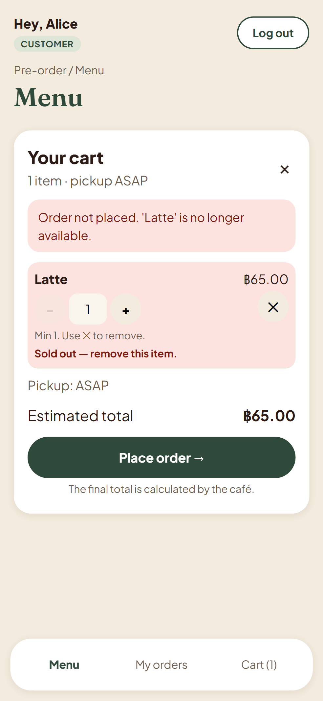
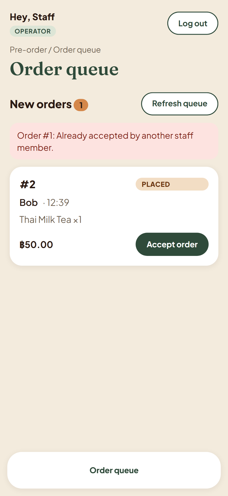

### Scenario 4 — Login, logout and a forbidden operation (F-01)

| | |
|---|---|
| Feature / AC | F-01 AC-F01-12, AC-F01-13, AC-F01-14 (TEST-F01-12..14); backend: AC-F01-10, AC-F03-09, AC-F04-09 |
| Role | anonymous → CUSTOMER (alice) → OPERATOR (staff) |
| Start | Logged out |
| Steps | Wrong password → right password → open `/operator/orders` as alice → log out → open `/menu` |
| Expected | "Incorrect email or password." (password cleared, email kept); alice lands on `/menu`; operator page → back to `/menu` with "You don't have access to that page."; after logout `/menu` → `/login` |
| Actual | As expected. Hiding the page is not the authorization: the API itself answers 403 to a customer on every operator endpoint and 404 for another customer's order (excerpt F.4.2) |

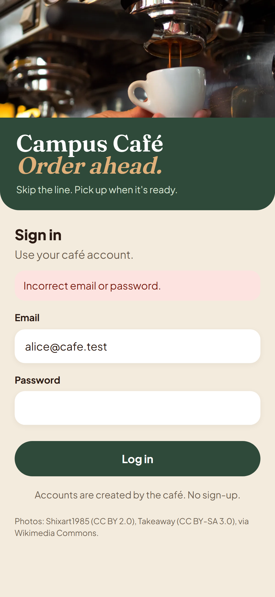
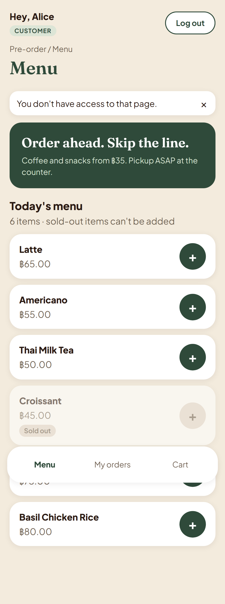

Desktop (1280 px) versions of every screenshot are in `docs/evidence/screenshots/*-desktop.png`, for example:

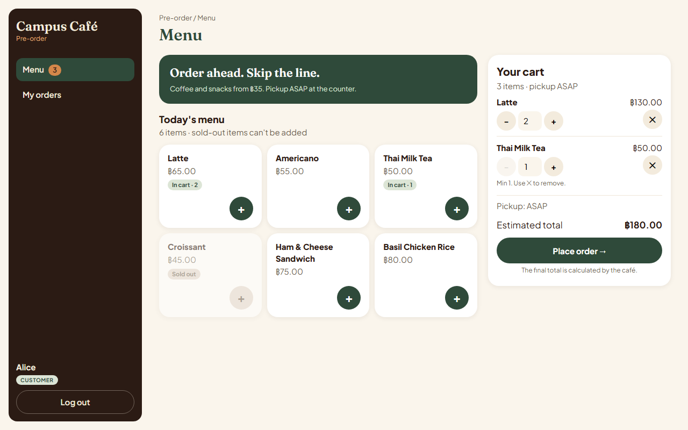
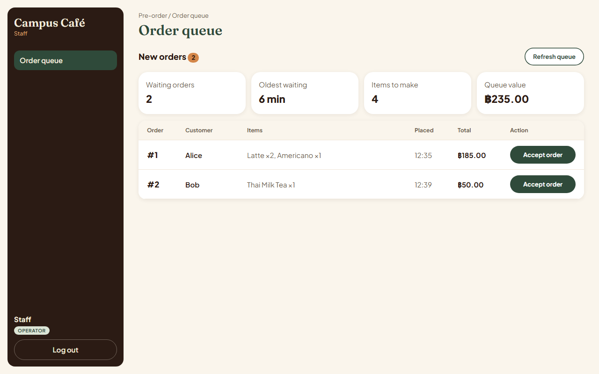

## F.3 Build and automated test results

All results below are **automated** tests. No manual check is counted as verification.

<!-- COUNTS -->
| Suite | Command | Exit code |
|---|---|---|
| server unit + API (real Postgres `cafe_test`) | `npm test -w server` | 0 |
| client unit | `npm test -w client` | 0 |
| E2E (Playwright, `cafe_e2e`) | `npm run test:e2e` | 0 |
| build | `npm run build` | 0 |

| Suite | Tests | Passed | Failed | Skipped |
|---|---|---|---|---|
| server | 65 | 65 | 0 | 0 |
| client | 6 | 6 | 0 | 0 |
| e2e phone | 10 | 10 | 0 | 0 |
| e2e desktop | 10 | 10 | 0 | 0 |
<!-- /COUNTS -->

Every single test with its result: `docs/evidence/test-run.md`.

### Acceptance criteria → planned test → actual test → result

<!-- AC-TABLE -->
46 AC; 46 Pass; 0 not Pass.

| AC | Criterion (short) | Planned tests | Test file › name | Result |
|---|---|---|---|---|
| AC-F01-01 | Seeded customer; POST login with correct email + password | TEST-F01-01 (API) | server/tests/auth.test.ts › TEST-F01-01 valid login returns the user, sets a safe cookie and stores an 8 h session | Pass |
| AC-F01-02 | Correct email, wrong password | TEST-F01-02 (API) | server/tests/auth.test.ts › TEST-F01-02 wrong password: 401, no cookie, no session | Pass |
| AC-F01-03 | Email that has no account | TEST-F01-03 (API) | server/tests/auth.test.ts › TEST-F01-03 unknown email gives exactly the same answer as a wrong password | Pass |
| AC-F01-04 | Body missing password, invalid email, or with an extra field `role: "OPERATOR"` | TEST-F01-04 (API) | server/tests/auth.test.ts › TEST-F01-04 missing password, bad email or an extra field: 400, no session | Pass |
| AC-F01-05 | Email typed in capitals `ALICE@CAFE.TEST` | TEST-F01-05 (API) | server/tests/auth.test.ts › TEST-F01-05 email is case-insensitive | Pass |
| AC-F01-06 | Valid session; GET me | TEST-F01-06 (API) | server/tests/auth.test.ts › TEST-F01-06 me returns only id, name and role | Pass |
| AC-F01-07 | GET me with no cookie, or with a made-up `sid` | TEST-F01-07 (API) | server/tests/auth.test.ts › TEST-F01-07 me without a cookie or with a made-up sid: 401 | Pass |
| AC-F01-08 | Session whose `expiresAt` has passed; GET me | TEST-F01-08 (API) | server/tests/auth.test.ts › TEST-F01-08 expired session: 401 and the row is deleted | Pass |
| AC-F01-09 | Logged in; POST logout, then GET me with the old cookie | TEST-F01-09 (API) | server/tests/auth.test.ts › TEST-F01-09 logout ends the session; the old cookie stops working | Pass |
| AC-F01-10 | A route protected by `requireRole("OPERATOR")` | TEST-F01-10 (API) | server/tests/auth.test.ts › TEST-F01-10 requireRole: wrong role 403, no session 401, right role 200 | Pass |
| AC-F01-11 | `NODE_ENV=production` | TEST-F01-11 (unit) | server/tests/auth.test.ts › TEST-F01-11 cookie is Secure only in production; always httpOnly, lax, 8 h | Pass |
| AC-F01-12 | UI: customer logs in / operator logs in / user logs out | TEST-F01-12 (E2E) | e2e/auth.spec.ts › TEST-F01-12 customer and operator land on their home; logout ends the session (phone + desktop) | Pass |
| AC-F01-13 | UI: wrong password | TEST-F01-13 (E2E) | e2e/auth.spec.ts › TEST-F01-13 wrong password shows the message, clears the password, keeps the email (phone + desktop) | Pass |
| AC-F01-14 | UI: not logged in opens `/menu`; customer opens `/operator/orders` | TEST-F01-14 (E2E) | e2e/auth.spec.ts › TEST-F01-14 guards: logged out -> /login; customer on operator page -> own home with notice (phone + desktop) | Pass |
| AC-F02-01 | Given a logged-in customer, when they request the menu, then they get 200 and every menu i | TEST-F02-01 (API) | server/tests/menu.test.ts › TEST-F02-01 customer gets every item with id, name, integer price and isAvailable, ordered by id | Pass |
| AC-F02-02 | Given an item marked sold out, when the menu is requested, then that item is still in the  | TEST-F02-02 (API) | server/tests/menu.test.ts › TEST-F02-02 sold-out item is still listed with isAvailable false | Pass |
| AC-F02-03 | Given no session (or an expired one), when the menu is requested, then the server answers  | TEST-F02-03 (API), TEST-F02-04 (API) | server/tests/menu.test.ts › TEST-F02-03 no session cookie: 401 UNAUTHENTICATED in the shared error shape<br>server/tests/menu.test.ts › TEST-F02-04 expired session: 401 UNAUTHENTICATED | Pass |
| AC-F02-04 | Given a logged-in operator, when they request the menu, then the server answers 403 `FORBI | TEST-F02-05 (API) | server/tests/menu.test.ts › TEST-F02-05 operator: 403 FORBIDDEN | Pass |
| AC-F02-05 | Given an empty `menu_items` table, when a customer requests the menu, then they get 200 wi | TEST-F02-06 (API) | server/tests/menu.test.ts › TEST-F02-06 empty menu: 200 with [] | Pass |
| AC-F02-06 | Given the customer opens `/menu`, then each item shows its name and price as `฿xx.xx`, and | TEST-F02-07 (unit), TEST-F02-08 (E2E) | client/src/lib/money.test.ts › TEST-F02-07 formats integer satang as ฿xx.xx<br>e2e/menu.spec.ts › TEST-F02-08 prices in baht; sold-out item greyed with a disabled add button (phone + desktop) | Pass |
| AC-F02-07 | Given the menu request fails (network or 500), then the page shows "Couldn't load the menu | TEST-F02-09 (E2E) | e2e/menu.spec.ts › TEST-F02-09 menu load error shows the message; Reload menu loads it (phone + desktop) | Pass |
| AC-F03-01 | Given a logged-in customer and available items, when they place an order with 1–20 lines o | TEST-F03-01 (API), TEST-F03-17 (unit) | server/tests/orders.test.ts › TEST-F03-01 places an order: 201 PLACED, server total, lines with copied name and price, saved<br>client/src/lib/cart.test.ts › TEST-F03-17 adding the same item twice gives one line with quantity 2 | Pass |
| AC-F03-02 | (BR-01) When any line has quantity 0, 11, a decimal, a negative number or a non-number, th | TEST-F03-02 (API), TEST-F03-03 (API), TEST-F03-22 (API) | server/tests/orders.test.ts › TEST-F03-02 BR-01 boundary: quantity 1 and 10 are accepted<br>server/tests/orders.test.ts › TEST-F03-03 BR-01 quantity 0 is rejected with 400 and nothing saved<br>server/tests/orders.test.ts › TEST-F03-03 BR-01 quantity 11 is rejected with 400 and nothing saved<br>server/tests/orders.test.ts › TEST-F03-03 BR-01 quantity 1.5 is rejected with 400 and nothing saved<br>server/tests/orders.test.ts › TEST-F03-03 BR-01 quantity -1 is rejected with 400 and nothing saved<br>server/tests/orders.test.ts › TEST-F03-03 BR-01 quantity 2 is rejected with 400 and nothing saved<br>server/tests/orders.test.ts › TEST-F03-03 BR-01 quantity null is rejected with 400 and nothing saved<br>server/tests/orders.test.ts › TEST-F03-22 ids above 2147483647 give 400, not 500, and nothing is saved | Pass |
| AC-F03-03 | (BR-02) When `items` is empty or has 21 lines, or the same item appears twice, then 400 `V | TEST-F03-04 (API), TEST-F03-05 (API), TEST-F03-06 (API), TEST-F03-07 (API) | server/tests/orders.test.ts › TEST-F03-04 BR-02 empty or missing items {"items":[]}: 400, nothing saved<br>server/tests/orders.test.ts › TEST-F03-04 BR-02 empty or missing items {}: 400, nothing saved<br>server/tests/orders.test.ts › TEST-F03-04 BR-02 empty or missing items {"items":"Latte"}: 400, nothing saved<br>server/tests/orders.test.ts › TEST-F03-05 BR-02 boundary: 20 different lines are accepted<br>server/tests/orders.test.ts › TEST-F03-06 BR-02 21 lines: 400, nothing saved<br>server/tests/orders.test.ts › TEST-F03-07 BR-02 the same item twice: 400 DUPLICATE, nothing saved | Pass |
| AC-F03-04 | (BR-03) When any item is sold out or does not exist, then 400 `VALIDATION_ERROR` naming th | TEST-F03-08 (API), TEST-F03-09 (API) | server/tests/orders.test.ts › TEST-F03-08 BR-03 a sold-out item rejects the whole order: 400 SOLD_OUT naming it, nothing saved<br>server/tests/orders.test.ts › TEST-F03-09 BR-03 an unknown item: 400 NOT_FOUND reason, nothing saved | Pass |
| AC-F03-05 | (BR-04) When the request contains `price`, `unitPrice` or `total` (top level or in a line) | TEST-F03-10 (API) | server/tests/orders.test.ts › TEST-F03-10 BR-04 client sends price on a line: 400, nothing saved<br>server/tests/orders.test.ts › TEST-F03-10 BR-04 client sends unitPrice on a line: 400, nothing saved<br>server/tests/orders.test.ts › TEST-F03-10 BR-04 client sends total at top level: 400, nothing saved | Pass |
| AC-F03-06 | (BR-05) Given a placed order, when the menu price or name changes later, then the order de | TEST-F03-11 (API) | server/tests/orders.test.ts › TEST-F03-11 BR-05 order keeps name and price from order time after the menu changes | Pass |
| AC-F03-07 | When a customer lists orders, then they get only their own orders, newest first, with id,  | TEST-F03-12 (API) | server/tests/orders.test.ts › TEST-F03-12 list shows only my orders, newest first, with item count | Pass |
| AC-F03-08 | When a customer opens their own order, then they get 200 with lines and total; when they o | TEST-F03-13 (API), TEST-F03-14 (API), TEST-F03-21 (API), TEST-F03-22 (API) | server/tests/orders.test.ts › TEST-F03-13 my own order detail: 200 with lines and total<br>server/tests/orders.test.ts › TEST-F03-14 another customer's order and a missing id both give the same 404<br>server/tests/orders.test.ts › TEST-F03-21 malformed id abc: 400 VALIDATION_ERROR<br>server/tests/orders.test.ts › TEST-F03-21 malformed id 0: 400 VALIDATION_ERROR<br>server/tests/orders.test.ts › TEST-F03-21 malformed id -1: 400 VALIDATION_ERROR<br>server/tests/orders.test.ts › TEST-F03-21 malformed id 1.5: 400 VALIDATION_ERROR<br>server/tests/orders.test.ts › TEST-F03-22 ids above 2147483647 give 400, not 500, and nothing is saved | Pass |
| AC-F03-09 | When not logged in, any F-03 endpoint answers 401; when logged in as operator, 403. | TEST-F03-15 (API), TEST-F03-16 (API) | server/tests/orders.test.ts › TEST-F03-15 not logged in: all F-03 endpoints give 401<br>server/tests/orders.test.ts › TEST-F03-16 operator: all F-03 endpoints give 403, nothing saved | Pass |
| AC-F03-10 | In the browser, a customer adds items (adding the same item twice gives quantity 2 on one  | TEST-F03-19 (E2E) | e2e/orders.spec.ts › TEST-F03-19 add Latte twice + Thai Milk Tea, place order, see server total and the order in My orders (phone + desktop) | Pass |
| AC-F03-11 | In the browser, when the server rejects the order with 400, the message is shown, the cart | TEST-F03-20 (E2E) | e2e/orders.spec.ts › TEST-F03-20 item sells out while in the cart: message names it, cart kept, line marked, nothing saved (phone + desktop) | Pass |
| AC-F03-12 | In the cart, the stepper cannot go below 1 or above 10, and at 20 lines no + on the menu a | TEST-F03-18 (unit), TEST-F03-23 (unit) | client/src/lib/cart.test.ts › TEST-F03-18 quantity is clamped to 1-10 and a 21st different item is refused<br>client/src/lib/cart.test.ts › TEST-F03-23 at 20 lines every menu + is disabled | Pass |
| AC-F04-01 | Orders in PLACED (created at different times) and ACCEPTED; operator GETs the queue | TEST-F04-01 (API) | server/tests/operator.test.ts › TEST-F04-01 shows only PLACED orders, oldest first, with customer, lines and total | Pass |
| AC-F04-02 | PLACED orders from alice and bob | TEST-F04-02 (API) | server/tests/operator.test.ts › TEST-F04-02 includes every customer's orders | Pass |
| AC-F04-03 | `?status=ACCEPTED` or `?status=nonsense` | TEST-F04-03 (API) | server/tests/operator.test.ts › TEST-F04-03 an unsupported status filter is a 400 | Pass |
| AC-F04-04 | A PLACED order; operator accepts it | TEST-F04-04 (API) | server/tests/operator.test.ts › TEST-F04-04 accepting a PLACED order saves ACCEPTED and removes it from the queue | Pass |
| AC-F04-05 | An ACCEPTED order; operator accepts it again (BR-06) | TEST-F04-05 (API) | server/tests/operator.test.ts › TEST-F04-05 BR-06 accepting an ACCEPTED order is a 409 and changes nothing | Pass |
| AC-F04-06 | An order in CANCELLED (set directly in the database); operator accepts (BR-06) | TEST-F04-06 (API) | server/tests/operator.test.ts › TEST-F04-06 BR-06 accepting a CANCELLED order is a 409 and it stays CANCELLED | Pass |
| AC-F04-07 | One PLACED order; 20 accept requests sent at the same time (BR-07, NFR-04) | TEST-F04-07 (API) | server/tests/operator.test.ts › TEST-F04-07 BR-07 twenty accepts at the same time: exactly one succeeds | Pass |
| AC-F04-08 | Accept id 999999 (no such order); accept id `abc` or 3000000000 (above 2147483647) | TEST-F04-08 (API), TEST-F04-14 (API) | server/tests/operator.test.ts › TEST-F04-08 missing order is 404, malformed id is 400<br>server/tests/operator.test.ts › TEST-F04-14 an id above 2147483647 gives 400, not 500 | Pass |
| AC-F04-09 | Customer session; no session — on both endpoints | TEST-F04-09 (API) | server/tests/operator.test.ts › TEST-F04-09 customers get 403 and anonymous users 401 on both endpoints; order unchanged | Pass |
| AC-F04-10 | `canTransition` | TEST-F04-10 (unit) | server/tests/transitions.test.ts › TEST-F04-10 Sprint 1 allows only PLACED -> ACCEPTED | Pass |
| AC-F04-11 | UI: operator logs in with 2 PLACED orders | TEST-F04-11 (E2E) | e2e/queue.spec.ts › TEST-F04-11 operator sees PLACED orders oldest first with the count (phone + desktop) | Pass |
| AC-F04-12 | UI: operator presses Accept order | TEST-F04-12 (E2E) | e2e/queue.spec.ts › TEST-F04-12 accept shows success and removes the card (phone + desktop) | Pass |
| AC-F04-13 | UI: order accepted elsewhere after the page loaded; operator presses Accept order | TEST-F04-13 (E2E) | e2e/queue.spec.ts › TEST-F04-13 order accepted elsewhere: 409 message and the list reloads (phone + desktop) | Pass |
<!-- /AC-TABLE -->

## F.4 Test excerpts

### F.4.1 Domain rule — BR-07: twenty accepts at the same time, exactly one wins

`server/tests/operator.test.ts` (TEST-F04-07, AC-F04-07). Setup: one PLACED order created in the test database.

```ts
it("TEST-F04-07 BR-07 twenty accepts at the same time: exactly one succeeds", async () => {
  const o = await makeOrder("alice@cafe.test", "PLACED");
  const results = await Promise.all(Array.from({ length: 20 }, () => accept(o.id)));
  const codes = results.map((r) => r.status).sort();
  expect(codes.filter((c) => c === 200)).toHaveLength(1);
  expect(codes.filter((c) => c === 409)).toHaveLength(19);
  expect(await statusOf(o.id)).toBe("ACCEPTED");
});
```

The code under test is one atomic conditional update (`server/src/operator/routes.ts`):

```ts
const { count } = await prisma.order.updateMany({
  where: { id, status: { in: statusesThatCanMoveTo("ACCEPTED") } },
  data: { status: "ACCEPTED", acceptedAt: new Date() },
});
```

| Version | Commit | Result (saved output) |
|---|---|---|
| Test written, no implementation `[red]` | `463f459` | **failed**: `AssertionError: expected [] to have a length of 1 but got +0` (`tdd/F-04-red.txt`) |
| Implementation `[green]` | `f729818` | **passed** (`tdd/F-04-green.txt`); passed 5 runs in a row and in every run since |

### F.4.2 Ownership restriction — another customer's order is not visible

`server/tests/orders.test.ts` (TEST-F03-14, AC-F03-08). Setup: bob places an order; alice (another customer) asks for it by id.

```ts
it("TEST-F03-14 another customer's order and a missing id both give the same 404", async () => {
  const bobs = await place(bob, { items: [{ menuItemId: menu["Latte"], quantity: 1 }] });
  const other = await get(alice, `/api/orders/${bobs.body.id}`);
  const missing = await get(alice, "/api/orders/99999");
  for (const res of [other, missing]) {
    expect(res.status).toBe(404);
    expect(res.body).toEqual({ error: { code: "NOT_FOUND", message: "Order not found.", details: null } });
  }
});
```

The server filters by owner inside the query, so no data from bob's order is ever loaded for alice (`server/src/orders/routes.ts`): `prisma.order.findFirst({ where: { id, customerId: req.user!.id } })`. Role checks work the same way: `requireRole("CUSTOMER")` / `requireRole("OPERATOR")` read the role from the session row, never from the request (TEST-F01-10, TEST-F03-16, TEST-F04-09).

| Version | Commit | Result (saved output) |
|---|---|---|
| Test written, no implementation `[red]` | `e922626` | **failed**: got the generic route 404 `"Not found."` instead of the specified `"Order not found."` (`tdd/F-03-red.txt`) |
| Implementation `[green]` | `13a2651` | **passed** (`tdd/F-03-green.txt`) |

## F.5 Engineering workflow and history

### Contract recorded before implementation

| Feature (owner) | Contract `[spec]` | Tests fail `[red]` | Code passes `[green]` | PR (reviewer) |
|---|---|---|---|---|
| F-01 Login (vieng) | `e187cf8` 03:35 | `d0d4eb9` 03:38 — 11 failed | `eebaf41` 03:39 — 11 passed | #22 (ninja) |
| F-02 Menu (ninja) | `6e25979` 03:35 | `3376cd3` 03:45 — 6 failed | `2816f63` 03:46 — 6 passed | #23 (vieng) |
| F-03 Orders (ninja) | `3178514` 03:36 | `e922626` 03:50 — 29 failed | `13a2651` 03:57 — 29 passed | #26 (vieng) |
| F-04 Accept (vieng) | `92470d8` 03:37 | `463f459` 03:46 — 10 failed | `f729818` 03:48 — 10 passed | #24 (ninja) |

Times are 6 Nov 2026, +07:00, from `git log`. Full Issue / branch / PR / reviewer table for every Issue: `docs/evidence/history.md`.

### Two completed Issues and their pull requests

| | Issue #5 — F-04 Operator queue and accept | Issue #4 — F-03 Place order, my orders, order detail |
|---|---|---|
| Contract | `docs/sprints/sprint-1/F-04-accept.md` (AC-F04-01..13, TEST-F04-01..13) | `docs/sprints/sprint-1/F-03-orders.md` (AC-F03-01..12, TEST-F03-01..21) |
| Branch (made from the Issue) | `feature/F-04-accept` | `feature/F-03-orders` |
| PR | #24 into `sprint-1` | #26 into `sprint-1` |
| Author → reviewer | vieng → ninja | ninja → vieng |
| Substantive review | Ran 34 + 1 tests and build; checked the atomic update for BR-06/07, the additive migration, the role guard; answered two design questions (desktop cards vs table → known UI debt) | Ran 63 + 5 tests, build, and the 16 E2E tests on top of the PR; checked BR-01..05 in code and tests; noted the row-lock limitation and comment style (fixed in #27) |
| Integration into staging | merged into `sprint-1`, merge commit `f7cabb1` | merged into `sprint-1`, merge commit `2244619` |
| Into `main` | at release (decided by vieng) | at release (decided by vieng) |


### Final board status

<!-- BOARD -->
Board https://github.com/users/vienggg/projects/4 read at 2026-11-05T23:43:33.655Z:

| Issue | Title | Column |
|---|---|---|
| #1 | Setup: schema, seed, project skeleton | Done |
| #2 | F-01 Login, logout, me (two roles) | Done |
| #3 | F-02 Browse menu | Done |
| #4 | F-03 Place order, my orders, order detail | Done |
| #5 | F-04 Operator queue and accept | Done |
| #6 | Docs A: SRS | Done |
| #7 | Docs B: Feature inventory + traceability | Done |
| #8 | Docs C: System SDS | Done |
| #9 | Docs D: 3-sprint plan | Done |
| #10 | E2E tests (Playwright) | Done |
| #11 | Release v0.1.0-sprint1 + PDF evidence | Done |
| #12 | Docs: final UI design (hi-fi screens + spec update) | Done |
| #14 | Docs: link issues to PRs by command in CLAUDE.md | Done |
| #28 | Docs B follow-up: fill AC and test IDs in traceability | Done |
| #31 | Deliverable 1 PDF (evidence index) | PR Review |
| #33 | Part F evidence section for the Deliverable 1 PDF | Done |
| #35 | Deliverable 1 PDF: render with Part F, screenshot layout | PR Review |
| #37 | Recheck fixes (ninja half): id overflow 500, cart UI vs spec, cover counts | Done |
| #38 | Recheck fixes (vieng half): notice, queue time, docs, no sideways scroll | Done |
| #41 | Final evidence run and PDF render on sprint-1 | Started |
<!-- /BOARD -->

## F.6 Contribution

| Area | vieng | ninja |
|---|---|---|
| Requirements and design | SRS (Doc A); SDS §1, 2, 5, 6, 7 (architecture, UI, roles, auth, config) | Feature inventory + traceability (Doc B); SDS §3, 4 (data model, API); sprint plan (Doc D) |
| Features (contract, tests, code) | Setup skeleton (#1), F-01 login, F-04 accept | F-02 menu, F-03 orders, client test setup |
| Testing and evidence | Playwright setup, E2E for F-01, F-02, F-04; evidence script; Part F | E2E for F-03; traceability results; PDF build |
| Reviews (approved and merged) | #16, #17, #21, #23, #26, #27, #29 | #18, #19, #20, #22, #24, #25, #30 |

Pair work: schema and seed (#1) were agreed together; shared code such as `requireRole`, `toOrderJson` and the order JSON shape were agreed in chat before either side wrote them.

## F.7 AI-use declaration

Both students used Claude Code (Anthropic) as a coding and documentation assistant, each in their own session, on bounded GitHub Issues with the feature contract as input. The AI drafted documents (SRS, SDS, plan, contracts, traceability), wrote the failing tests first and then the implementation, built the UI screens, ran the tests and produced this evidence. The two AI sessions coordinated through a private chat relay.

With each student's permission, each AI session also opened pull requests and **reviewed, approved and merged the other student's pull requests on that student's GitHub account**, after running the code and tests; the review text on each PR is the AI's written check. No session approved or merged a pull request written by its own student. Both students are responsible for the result and can explain the design, tests and released behaviour.

## F.8 Known limitations, incomplete work, failed and skipped tests

- **Failed / skipped tests:** none in the run in F.3 (counts above). No test was disabled or weakened.
- **Process exceptions (setup, documents only):** PRs #13 and #15 were merged by their author without review, and four commits were pushed directly by the repo owner (`5f85976`, `810c7e3`, `2797462`, `d92baf0`). Every PR from #16 on was reviewed and merged by the other student. Details: `history.md`.
- Branch `feature/F-03-e2e` is linked to Issue #10 through PR #27; the branch link under "Development" is added on the website.
- F-03 reads menu items without a row lock inside the order transaction. In Sprint 1 nothing changes availability while the app runs, so no race exists yet; revisit with F-05 (menu management).
- Not done yet: release to `main` and tag `v0.1.0-sprint1` (the students' decision); Docker image, CI/CD and GCP deployment (Lab 5).
